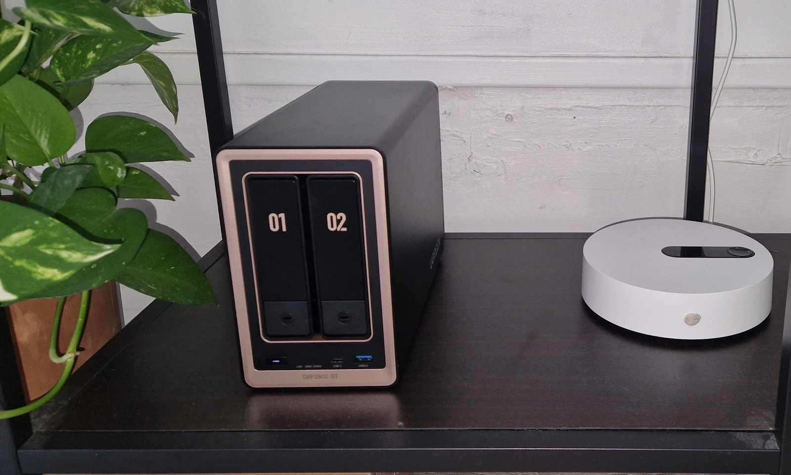

import Brand from '@/components/Brand.astro';
import StackedBar from '@/components/StackedBar.astro';
import Note from '@/components/Note.astro';
import { Specs, Spec } from '@/components/specs';

This is the first part of [a series](/series/nas/) about my home server: a NAS I wanted to fully control,
robust, and getting updates daily. In this one: why I started, what I wanted to run on it, and how I picked
the hardware.

## The trigger: OneDrive and the Samsung Gallery

With my Samsung phone, I've used the Samsung Gallery synced with my Microsoft OneDrive account to store
my pictures since forever, paying 2 € per month for 100 GB of OneDrive. The integration offered the Samsung UI and features
with the OneDrive storage, so I was pretty happy about it.

However, when Samsung ended the sync with OneDrive[^samsung][^samsungch], all images which were not downloaded on my
phone disappeared from the gallery. I had to use both apps to browse my gallery.

In addition, my OneDrive was full for quite some time, and I was constantly deleting photos and videos to make some room.
If I wanted more, the next storage tier for OneDrive jumps from 2 € to 6.99 € per month. Other cloud providers may be cheaper, but
migrating is always a pain, and if I had to switch anyway, I'd rather self-host.

## Why build it myself

Depending as little as possible on a third party to store my memories was one of the goals, but let's be honest: I wanted
to have fun building and experimenting with my own home server.

I'm a software engineer at <Brand name="redhat" />, working on <Brand name="podman-desktop" />, and as our team is building
tools for developers using technologies like <Brand name="bootc">bootable containers (bootc)</Brand> and <Brand name="podman" />,
I wanted to use those technologies on my own to get as close as possible to a real production environment.

Another aspect I found interesting: with the growing number of security vulnerabilities appearing at every level
(PHP2Shell in PHP[^php2shell], NoisyTCP in the Linux kernel[^noisytcp], nginx2root in nginx[^nginx2root]), I wanted to find how I could leverage those tools to make self-hosting
robust, keep the data safe, and ensure my system gets updates daily. That's the primary goal of this series.

<Note label="Disclosure">
This is a personal project, and I am _obviously_ biased in the technologies I choose, especially as I work at <Brand name="redhat" />.
</Note>

## What I wanted to run

I spent quite some time deciding which projects would match my needs (I won't go into the details of why for each one here). The initial list is <Brand name="immich" /> for the
photos and videos, <Brand name="paperless" /> for the documents, and <Brand name="vaultwarden" /> for the password management.

Before selecting the hardware I ran some measurements in a dedicated Fedora VM, to orient my search.
What I found out: about 3 GB of RAM for the three apps (at rest), but Immich's machine learning loads models when it works, and they mention a minimum of 6 GB[^immich]
(the OS is not counted in this chart).

<StackedBar
  title="RAM the three apps need"
  subtitle="Measured in a Fedora VM with 4 GB of RAM, Immich at first start; the OS is not included."
  unit="GB"
  max={8}
  ticks={[0, 2, 4, 6, 8]}
  totalLabel="Total"
  segments={[
    { label: 'Immich', value: 2.37, detail: 'server 1.54, Postgres 0.62, machine learning 0.21' },
    { label: 'Paperless-ngx', value: 0.58, detail: 'Paperless 0.575, Valkey 0.007' },
    { label: 'Vaultwarden', value: 0.06, detail: 'one process, SQLite' },
  ]}
/>

With those results _and with the price of the RAM_ I thought it would be fine to start with 8 GB of RAM.
_(Spoiler: Immich can use 3 to 5 GB during its first import, so I added a 16 GB stick later, found for 50 €.)_

## What I was looking for

As this was my first NAS/home server, I wanted to start small. I don't really need a lot of storage: I have about 100 GB of images and videos.
I expect this to grow in the future, but a few TB would be enough for a very long time.

As I have a lot of personal projects, the home server will probably host some of my apps in the future, so I wanted a decent CPU,
an upgradable RAM slot, and preferably a "cheap" solution.

For the storage, I wanted 2 disks mirroring each other, so a dead disk doesn't lose anything, and an off-site backup in case the NAS is lost.

<Note label="Info">
From the beginning, I wanted to buy a NAS and replace the OS, to have full control over it, more like a home server.
</Note>

## Why UGREEN

I searched online for those criteria, and between <Brand name="synology" /> and <Brand name="ugreen" />, I chose UGREEN because their NAS
usually have a better CPU in similar price ranges.

I was looking for either the [UGREEN NASync DXP2800][dxp2800] (Intel N100) or the [GT][ugreen] version (AMD).
I was lucky to find the GT version on <Brand name="leboncoin" />.

## The design

This is the one I bought. I find it slim and cool-looking.

## What's inside

For the price I'm pretty happy with the specs: the CPU was released in 2022 and the box has 8 GB of RAM, so I feel like this should last
some time. Here is all the hardware:

<Specs>
  <Spec icon="cpu" label="Processor">[AMD Ryzen Embedded R2514][amd], 4 cores / 8 threads, Radeon Vega iGPU with hardware video encoding</Spec>
  <Spec icon="memory-stick" label="Memory">2 DDR4 SO-DIMM slots: 8 GB from the factory, 24 GB with a 16 GB [Lexar][lexar] module added</Spec>
  <Spec icon="microchip" label="System disk">[WD_BLACK SN7100][sn7100] 1 TB NVMe for the OS and the apps; a second M.2 slot is free</Spec>
  <Spec icon="hard-drive" label="Data disks">2× [WD Red Plus][redplus] 4 TB (CMR), mirrored: 4 TB usable</Spec>
  <Spec icon="ethernet-port" label="Network">One 10 GbE port</Spec>
  <Spec icon="shield-check" label="Security">TPM 2.0, used later to encrypt the disks</Spec>
</Specs>

<Note label="Next">
Part 2 replaces UGREEN's OS with my own: the whole NAS becomes a container image.
</Note>

## Second hand for the box, new for the disks

To reduce the cost of my project, I bought the box and the RAM second hand on <Brand name="leboncoin" />; the disks and SSD I bought new,
because I want to have the warranty if anything happens.

| Item | Where | Bought | Price |
|---|---|---:|---:|
| [UGREEN NASync DXP2800 GT][ugreen] | leboncoin | Sep 2026 | 329 € |
| [Lexar DDR4-3200 16 GB][lexar] | leboncoin | Nov 2026 | 50 € |
| [WD_BLACK SN7100 1 TB NVMe][sn7100] | Amazon | Nov 2026 | 196 € |
| 2× [WD Red Plus 4 TB][redplus] | Amazon | Nov 2026 | 437 € |
| **Total** | | | **1,012 €** |

{/* Vendor pages, checked 2026-11-22. The SN7100 is now sold by SanDisk as the "Optimus GX 7100";
UGREEN's store answers bots with HTTP 429, the URL comes from search results. AMD has no page per
model, so it links the R2000 series. UGREEN lists RAM expandable to 64 GB. */}

[ugreen]: https://ai-eu.ugreen.com/products/ugreen-nasync-dxp2800-gt-2-bay-nas-storage
[dxp2800]: https://nas-eu.ugreen.com/products/ugreen-nasync-dxp2800-nas-storage
[amd]: https://www.amd.com/en/products/embedded/ryzen/ryzen-r2000-series.html
[lexar]: https://www.lexar.com/global/products/Lexar-DDR4-SODIMM-Laptop-Memory/
[sn7100]: https://www.sandisk.com/products/ssd/internal-ssd/wd-black-sn7100-nvme-internal-ssd?sku=WDS100T4X0E-00CJA0
[redplus]: https://www.westerndigital.com/products/internal-drives/wd-red-plus-sata-3-5-hdd?sku=WD40EFZZ

## Will it ever pay for itself?

The honest answer is never. Storage prices have mostly been flat for years: storing a GB on Amazon S3 costs
the same as in 2016[^s3], my 2 € OneDrive plan never changed, and hard drives even got more expensive
recently[^hddprices].

If the goal was to save money, replacing 2 €/month (24 €/year) with a home server, where I need to pay for the hardware, the
electricity, and potential new pieces in case of failure, I don't think I will be saving a lot! The hardware alone is
42 years of my OneDrive plan, and the electricity (15 to 20 W at idle[^nbc], at about 0.20 € per kWh[^edf]) already
costs more than 2 € per month.

[^samsung]: [Samsung Cloud: Sync with OneDrive ending soon](https://www.samsungcloud.com/en/about/sync-with-onedrive-ending-soon?faq=faq1).
[^samsungch]: [Samsung: What has changed with Sync with OneDrive in the Gallery app](https://www.samsung.com/ch_fr/support/mobile-devices/what-has-changed-with-sync-with-onedrive-in-the-gallery-app/).
[^php2shell]: [oss-security: CVE-2026-109618, PHP 8.2–8.5 RCE via OOM corruption](https://www.openwall.com/lists/oss-security/2026/10/21/6) (October 2026, fixed in PHP 8.2.35, 8.3.36, 8.4.27 and 8.5.12).
[^noisytcp]: [NVD: CVE-2026-99288](https://nvd.nist.gov/vuln/detail/CVE-2026-99288) ("NoisyTCP", November 2026, a pre-authentication crash in the kernel's TCP lookups).
[^nginx2root]: [oss-security: CVE-2026-123633, CVE-2026-123007, nginx RCE via HTTP/2](https://www.openwall.com/lists/oss-security/2026/11/18/16) (November 2026).
[^immich]: [Immich documentation: Requirements](https://docs.immich.app/install/requirements/) (6 GB minimum, 8 GB recommended).
[^s3]: [AWS News Blog: S3 and Glacier price reductions](https://aws.amazon.com/blogs/aws/aws-storage-update-s3-glacier-price-reductions/): S3 Standard at $0.023 per GB per month from December 2016, still the price in 2026.
[^hddprices]: [TechPowerUp: HDD prices increase by an average of 46% over the past four months](https://www.techpowerup.com/345260/hdd-prices-increase-by-an-average-of-46-over-the-past-four-months) (January 2026).
[^nbc]: [Notebookcheck: Small, fast and surprisingly quiet: Ugreen NASync DXP2800 GT review](https://www.notebookcheck.net/Small-fast-and-surprisingly-quiet-Ugreen-NASync-DXP2800-GT-review.1423049.0.html).
[^edf]: [EDF: Prix du kWh de l'électricité](https://particulier.edf.fr/fr/accueil/guide-energie/electricite/prix-kwh-electricite.html).
